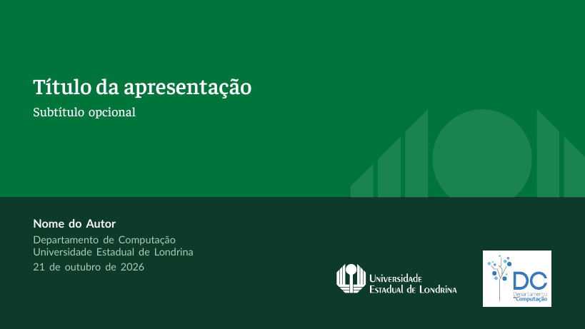
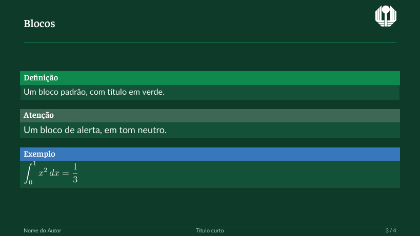
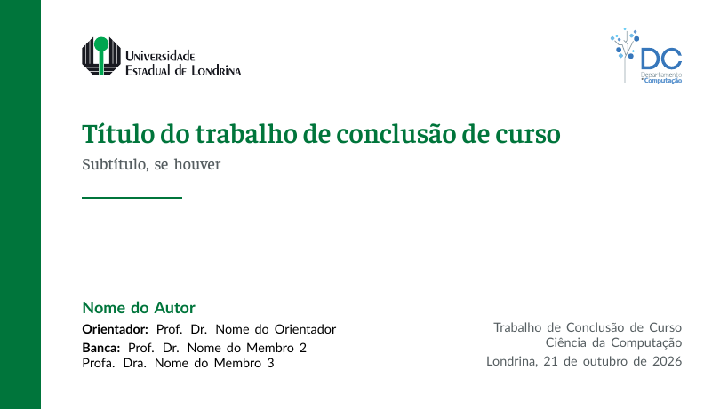
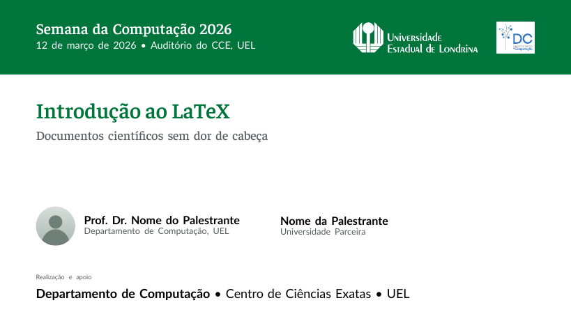
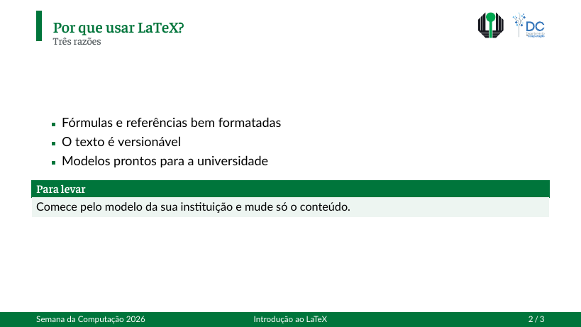
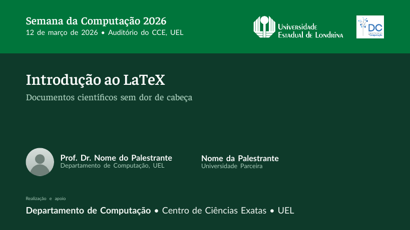
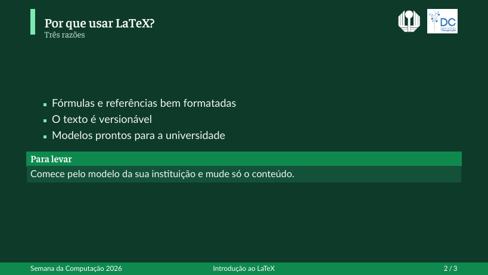

# uel-latex-templates

Modelos não oficiais de slides em Beamer para a Universidade Estadual de Londrina
(UEL), seguindo o [manual de identidade visual](docs/identitymanual.pdf): Verde
UEL, logotipos oficiais, Faustina nos títulos e Lato no texto. Todos os modelos
trazem também o logotipo do Departamento de Computação (DC), que pode ser
desligado, e existem em versão **clara** e **escura**.

## Modelos

Cada pasta de [`slides/`](slides/) reúne um tipo de apresentação, com o tema claro
e o escuro lado a lado.

| Pasta | Temas | Para quê |
|---|---|---|
| [`slides/geral`](slides/geral/) | `UEL`, `UELdark` | palestras, seminários, aulas simples |
| [`slides/aula`](slides/aula/) | `UELaula`, `UELauladark` | aulas: disciplina no cabeçalho, teoremas, exercícios, código |
| [`slides/defesa`](slides/defesa/) | `UELdefesa`, `UELdefesadark` | defesas de TCC, com barra de progresso, orientador e banca |
| [`slides/evento`](slides/evento/) | `UELevento`, `UELeventodark` | eventos e extensão: palestrantes com foto e logotipos de apoio |

O tema claro tem fundo branco; o escuro usa um verde-esmeralda escuro, bom para
salas com pouca luz e para telas.

### Exemplos

Cada pasta tem dois exemplos, `exemplo.tex` (claro) e `exemplo-dark.tex` (escuro).
Em cada linha: título e conteúdo no tema claro, depois no escuro.

**`geral`**

   

**`aula`**

   

**`defesa`**

   

**`evento`**

   

## Requisitos

- **XeLaTeX ou LuaLaTeX** e `latexmk`; os temas não funcionam com pdfLaTeX.
  Foram desenvolvidos e testados com o TeX Live 2026.
- **Lato**, instalada no sistema: `sudo apt install fonts-lato` no Debian e no
  Ubuntu, ou baixe no [Google Fonts](https://fonts.google.com/specimen/Lato). Sem
  ela, o tema avisa e usa a Latin Modern Sans.
- A Faustina já está incluída em [`fonts/`](fonts/) (licença SIL OFL); não há
  nada para instalar.

## Início rápido

1. Clone o repositório e compile um exemplo para conferir se o ambiente está
   certo:

   ```sh
   git clone <este repositório>
   cd uel-latex-templates/slides/geral
   latexmk exemplo.tex          # gera exemplo.pdf (tema claro)
   latexmk exemplo-dark.tex     # gera exemplo-dark.pdf (tema escuro)
   ```

2. Comece a sua apresentação copiando a pasta do tipo escolhido para dentro de
   `slides/`, para que o tema encontre `fonts/` e `img/`:

   ```sh
   cd uel-latex-templates/slides
   cp -r aula minha-aula
   cd minha-aula
   mv exemplo.tex slides.tex    # o exemplo claro, ou exemplo-dark.tex para o escuro
   ```

3. Edite o `slides.tex` e compile:

   ```sh
   latexmk slides.tex                # XeLaTeX (definido no latexmkrc)
   latexmk -lualatex slides.tex      # ou LuaLaTeX
   latexmk -pvc slides.tex           # recompila a cada alteração do arquivo
   ```

   Os slides de título posicionam os logotipos com TikZ, o que exige duas
   compilações; o `latexmk` faz as duas. Se um logotipo ou o layout do título
   parecer errado depois de uma única execução do `xelatex`, execute-o de novo.

## Escrevendo uma apresentação

Uma apresentação mínima:

```latex
\documentclass[aspectratio=169,10pt]{beamer}
\usepackage[brazil]{babel}

\usetheme{UEL}                 % claro; UELdark para o escuro

\title[Título curto]{Título da apresentação}   % [forma curta] aparece no rodapé
\subtitle{Subtítulo, se houver}
\author[Nome]{Nome do Autor}
\institute{Departamento de Computação\\Universidade Estadual de Londrina}
\date{\today}

\begin{document}

\maketitle                     % o slide de título; não o coloque dentro de um frame

\begin{frame}{Sumário}
  \tableofcontents
\end{frame}

\section{Introdução}           % cria um slide separador automaticamente (não em defesa e evento)

\begin{frame}{Um título de slide}{Subtítulo opcional}
  \begin{itemize}
    \item Um item com \alert{destaque}
    \item Outro item
  \end{itemize}
\end{frame}

\end{document}
```

Para trocar de claro para escuro (ou de tipo), basta mudar o nome em `\usetheme`:
os dois temas de cada pasta têm os mesmos comandos.

O que os temas estilizam e como usar:

| Você escreve | Você obtém |
|---|---|
| `\begin{frame}{Título}{Subtítulo}` | título do slide, com subtítulo opcional |
| `\section{…}`, `\tableofcontents` | slides separadores (só em `geral` e `aula`) e uma lista de conteúdo |
| `itemize`, `enumerate` | marcadores quadrados e numeração na cor de destaque do tema |
| `\alert{…}` | ênfase em negrito, no azul do DC |
| `block`, `alertblock`, `exampleblock` | blocos verde, cinza e azul |
| `columns` | conteúdo lado a lado |
| `\begin{frame}[fragile]` | necessário em volta de `verbatim` e de listagens de código |
| `\begin{frame}[plain]` | slide sem rodapé, para figuras que ocupam toda a largura |

Cada tipo tem comandos próprios, descritos no README da sua pasta:

| Pasta | Comandos próprios |
|---|---|
| `geral` | `\obrigado` |
| `aula` | `\disciplina`, `\aula`, `\semestre`; ambientes `theorem`, `definition`, `exercicio`; listagens de código. Use `brazil` também como opção da classe para os nomes em português |
| `defesa` | `\orientador`, `\banca`, `\curso`, `\obrigado` |
| `evento` | `\evento`, `\datalocal`, `\palestrante`, `\apoio`, `\obrigado` |

Dicas:

- Os temas foram feitos para **16:9**, em **10pt**; mantenha
  `\documentclass[aspectratio=169,10pt]{beamer}`. O texto é menor que o padrão do
  Beamer de propósito.
- Defina formas curtas com `\title[…]{…}` e `\author[…]{…}`; elas aparecem no
  rodapé, onde as formas longas não caberiam.
- Coloque as figuras numa subpasta, como `figuras/`, e use `\includegraphics`.
  Para diagramas, prefira PDF ou SVG convertido para PDF em vez de PNG.
- Para todo o resto sobre slides, consulte o
  [guia do usuário do Beamer](https://ctan.org/pkg/beamer): os temas mudam apenas
  a aparência.

### Opções dos temas

Passe as opções ao tema, por exemplo `\usetheme[nodc,nowatermark]{UEL}`.

| Opção | Efeito | Pastas |
|---|---|---|
| `nodc` | omite o logotipo do DC, para slides apenas da UEL | todas |
| `nowatermark` | sem o símbolo esmaecido nos slides de título e de seção | `geral` |
| `nosectionpage` | sem o slide separador automático em cada `\section` | `geral`, `aula` |
| `noprogress` | sem a barra de progresso | `defesa` |
| `fontpath=<pasta>` | onde estão os arquivos `.ttf` da Faustina, terminando com `/` | todas |
| `logopath=<pasta>` | onde estão os PDFs dos logotipos, terminando com `/` | todas |

O README de cada pasta lista todos os seus comandos e opções.

## Usando um tema fora deste repositório

Um tema procura `fonts/` e `img/logos/pdf/` na pasta do seu documento e nas duas
pastas acima dela. Qualquer uma destas configurações funciona:

- **Copiar a pasta para dentro de `slides/`**, como no início rápido. Não há mais
  nada a configurar.
- **Copiar os arquivos para o seu projeto**: os arquivos `.sty` da pasta do tipo
  escolhido (todos eles: os dois temas, as cores e as fontes), mais `fonts/` e
  `img/logos/pdf/` deste repositório, ao lado do seu `.tex` (ou até duas pastas
  acima).
- **Deixar o repositório onde está** e apontar para ele. Coloque a pasta do tipo
  escolhido no `TEXINPUTS` (note o `//` e o `:` final) e informe os caminhos dos
  recursos:

  ```latex
  \usetheme[fontpath=/home/voce/uel-latex-templates/fonts/,
            logopath=/home/voce/uel-latex-templates/img/logos/pdf/]{UEL}
  ```

  ```sh
  TEXINPUTS=/home/voce/uel-latex-templates/slides/geral//: latexmk -xelatex slides.tex
  ```

  Para não digitar o `TEXINPUTS`, copie os arquivos `.sty` para
  `~/texmf/tex/latex/uel/` e mantenha as duas opções acima.

## Solução de problemas

| Mensagem ou sintoma | Causa e solução |
|---|---|
| `The UEL theme needs XeLaTeX or LuaLaTeX` | você executou o `pdflatex`; use `latexmk` ou `xelatex` |
| `Logo files not found` | copie `img/logos/pdf/` para junto do documento ou defina `logopath` |
| aviso `Faustina not found` | copie `fonts/` para junto do documento ou defina `fontpath`; os títulos usam uma fonte serifada padrão |
| aviso `Lato not found` | instale a Lato (veja Requisitos) |
| Logotipos ou bloco do título fora do lugar | compile uma segunda vez (o `latexmk` faz isso) |
| `verbatim` ou código dentro de um frame dá erro | adicione `[fragile]`: `\begin{frame}[fragile]` |
| *Definition* e *Theorem* em inglês (`aula`) | passe `brazil` também como opção da classe: `\documentclass[…,brazil]{beamer}` |

## Estrutura do repositório

```
slides/
  geral/ aula/ defesa/ evento/          uma pasta por tipo: temas claro e escuro (.sty),
                                        exemplo.tex, exemplo-dark.tex, README, previews/
fonts/                    Faustina (instâncias estáticas das fontes variáveis do Google Fonts)
img/logos/                logotipos da UEL (eps/, png/ originais; pdf/ para o LaTeX) e do DC (dc/ SVGs)
docs/                     o manual de identidade visual
```

Os temas escuros se afastam do manual de propósito: usam um fundo verde-esmeralda
escuro e verdes derivados, e o logotipo do DC fica sobre uma placa branca porque
não tem versão negativa. O README da pasta `geral` diz exatamente o que é derivado.

Estes modelos não são endossados pela UEL. Use os logotipos conforme as regras de
identidade da universidade e consulte o manual antes de mudar a posição ou as
cores deles.
