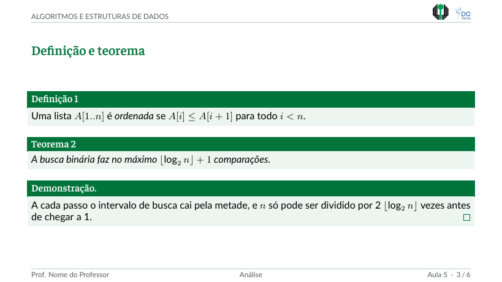
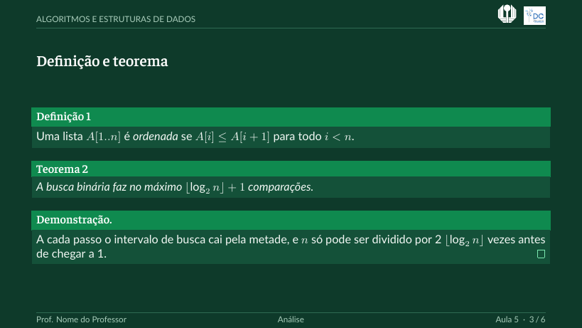

# aula

Temas Beamer para aulas na Universidade Estadual de Londrina, com o logotipo do
Departamento de Computação (DC). Cabeçalho com o nome da disciplina, ambientes de
teorema e de exercício, e um estilo para listagens de código. Feitos para 10pt, em
16:9.

| | Slide de título | Slide de conteúdo |
|---|---|---|
| **Claro** (`UELaula`) |  |  |
| **Escuro** (`UELauladark`) |  |  |

Mesma paleta e mesmas fontes da pasta [`geral`](../geral/); o tema escuro usa a
paleta verde-esmeralda descrita no README daquela pasta.

## Uso

Requer **XeLaTeX ou LuaLaTeX**. A Lato precisa estar instalada
([Google Fonts](https://fonts.google.com/specimen/Lato)); a Faustina já está
incluída em `../../fonts/`.

```sh
cd slides/aula
latexmk exemplo.tex          # tema claro
latexmk exemplo-dark.tex     # tema escuro
```

```latex
\documentclass[aspectratio=169,10pt,brazil]{beamer}
\usepackage[brazil]{babel}
\usetheme{UELaula}        % ou UELauladark

\title{Busca binária}
\subtitle{Procurando em listas ordenadas}
\author{Prof. Dr. Nome do Professor}
\institute{Departamento de Computação\\Universidade Estadual de Londrina}
\disciplina{Algoritmos e Estruturas de Dados}
\aula{5}
\semestre{2026/1}
```

Passe **`brazil` também como opção da classe**: sem isso, o Beamer escreve
*Definition* e *Theorem* em inglês, porque fixa esses nomes antes de o `babel` ser
carregado.

| Comando | Efeito |
|---|---|
| `\disciplina{…}`, `\aula{…}`, `\semestre{…}` | nome da disciplina (no cabeçalho e no título), número da aula e semestre |
| `definition`, `theorem`, `lemma`, `proof`, `example`… | ambientes do Beamer, numerados, com os nomes em português |
| `\begin{exercicio}[dica]…\end{exercicio}` | bloco *Exercício N*, com um complemento opcional entre colchetes |
| `\begin{lstlisting}[language=Python]` | código no estilo do tema; use `\begin{frame}[fragile]` |

O cabeçalho mostra a disciplina e os logotipos; o rodapé mostra o professor, a
seção e *Aula N · página/total*. Para uma versão para impressão, use a opção
`handout` da classe: `\documentclass[aspectratio=169,10pt,brazil,handout]{beamer}`.

As listagens usam o pacote `listings` (palavras-chave, comentários e textos entre
aspas ganham cores do tema); defina a linguagem com `language=…`.

| Opção | Efeito |
|---|---|
| `fontpath=<pasta>` | pasta com os arquivos `.ttf` da Faustina |
| `logopath=<pasta>` | pasta com os PDFs dos logotipos |
| `nodc` | omite o logotipo do DC (slides apenas da UEL) |
| `nosectionpage` | sem o slide separador automático em cada `\section` |

O tema procura `fonts/` e `img/logos/pdf/` na pasta do documento e nas duas
pastas acima dela. Para usá-lo em outro lugar, copie os arquivos `.sty` desta
pasta e essas duas pastas para junto do seu `.tex`.

Para um guia completo de como montar uma apresentação, veja o
[README principal](../../README.md).
